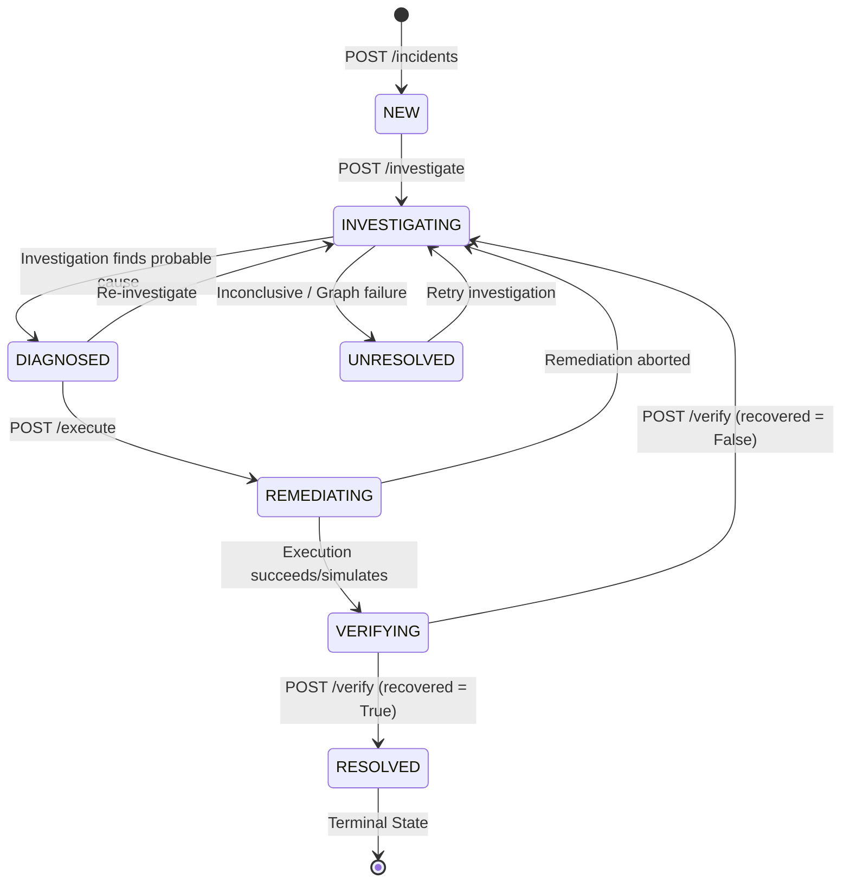

# OpsMind AI — Backend API Readiness Specification

## 1. Executive Summary

This document specifies the exact API contracts, lifecycle state machine, error handling protocols, and frontend integration notes for the OpsMind AI backend platform (`C:\projects\opsmind-ai`).

OpsMind AI empowers engineering and SRE teams to automate the incident investigation and resolution lifecycle:
$$\text{Incident} \to \text{Evidence Collection} \to \text{Timeline Construction} \to \text{Hypothesis Generation} \to \text{Diagnosis} \to \text{Remediation Planning} \to \text{Approval Gate} \to \text{Action Execution} \to \text{Verification} \to \text{Resolved}$$

All endpoints are implemented in FastAPI, fully secured via JWT bearer authentication, backed by SQLModel/SQLAlchemy persistence, and adhere to strict state transition and idempotency guards.

---

## 2. Verified Endpoints & API Reference

All routes are prefixed with `/api/v1`.

### 2.1 Authentication & User Management

#### `POST /api/v1/auth/register`
- **Description:** Register a new user account.
- **Rate Limit:** 5 requests / minute.
- **Request Body (`UserRegisterRequest`):**
  ```json
  {
    "email": "engineer@opsmind.ai",
    "password": "SecurePassword123!",
    "full_name": "Jane Engineer"
  }
  ```
- **Response (`UserResponse`):** Status `201 Created`
  ```json
  {
    "id": 1,
    "email": "engineer@opsmind.ai",
    "full_name": "Jane Engineer",
    "role": "responder",
    "is_active": true,
    "created_at": "2026-10-10T00:00:00Z"
  }
  ```
- **Errors:** `400 Bad Request` (Email already registered or validation failure).

#### `POST /api/v1/auth/token`
- **Description:** Authenticate user and receive JWT bearer access token.
- **Rate Limit:** 10 requests / minute.
- **Request Body (`OAuth2PasswordRequestForm`):** `application/x-www-form-urlencoded`
  - `username`: Email string
  - `password`: Password string
- **Response (`TokenResponse`):** Status `200 OK`
  ```json
  {
    "access_token": "eyJhbGciOi...",
    "token_type": "bearer",
    "expires_in": 3600
  }
  ```
- **Errors:** `401 Unauthorized` (Invalid credentials).

---

### 2.2 Incident Management & Lifecycle

All incident endpoints require `Authorization: Bearer <token>`.

#### `POST /api/v1/incidents`
- **Description:** Create a new incident. Status initializes to `new`.
- **Request Body (`IncidentCreateRequest`):**
  ```json
  {
    "title": "Checkout latency spike",
    "service": "checkout",
    "severity": "high",
    "description": "p95 latency rose from 200ms to 2.6s"
  }
  ```
- **Response (`IncidentResponse`):** Status `201 Created`
  ```json
  {
    "id": "inc-a1b2c3d4",
    "title": "Checkout latency spike",
    "description": "p95 latency rose from 200ms to 2.6s",
    "status": "new",
    "severity": "high",
    "resolved_at": null,
    "created_at": "2026-10-10T00:00:00Z"
  }
  ```

#### `GET /api/v1/incidents`
- **Description:** List all incidents, ordered most recent first.
- **Response (`list[IncidentResponse]`):** Status `200 OK`

#### `GET /api/v1/incidents/{incident_id}`
- **Description:** Retrieve full aggregate details of an incident including active diagnosis, hypotheses, remediations, approvals, executions, and verifications.
- **Response (`IncidentResultsResponse`):** Status `200 OK`
  ```json
  {
    "incident": { "id": "inc-a1b2c3d4", "status": "diagnosed", ... },
    "hypotheses": [ ... ],
    "diagnosis": { "id": 1, "probable_cause": "...", "confidence": 0.85, ... },
    "remediations": [ ... ],
    "approvals": [ ... ],
    "action_executions": [ ... ],
    "verifications": [ ... ]
  }
  ```
- **Errors:** `404 Not Found`.

#### `GET /api/v1/incidents/{incident_id}/timeline`
- **Description:** Retrieve append-only chronological event log of the incident.
- **Response (`list[TimelineEntryResponse]`):** Status `200 OK`
- **Errors:** `404 Not Found`.

#### `GET /api/v1/incidents/{incident_id}/evidence`
- **Description:** Retrieve persisted raw telemetry evidence (logs, metrics, deployments) gathered for this incident.
- **Response (`list[EvidenceResponse]`):** Status `200 OK`
- **Errors:** `404 Not Found`.

---

### 2.3 Automated Investigation Engine

#### `POST /api/v1/incidents/{incident_id}/investigate`
- **Description:** Run LangGraph automated investigation pipeline. Advances status to `investigating`, then `diagnosed` (or `unresolved`). Automatically generates and links grounded remediation and approval if a diagnosis is identified.
- **Request Body (`InvestigateRequest`):**
  ```json
  {
    "service": "checkout",
    "window_start": "2026-09-06T10:00:00Z",
    "window_end": "2026-09-06T10:15:00Z"
  }
  ```
- **Response (`InvestigateResponse`):** Status `200 OK`
  ```json
  {
    "incident_id": "inc-a1b2c3d4",
    "status": "diagnosed",
    "evidence_count": 8,
    "hypothesis_count": 2,
    "diagnosis_id": 1,
    "probable_cause": "A downstream dependency timeout regression caused the incident",
    "confidence": 0.85,
    "remediation_id": 1,
    "risk_level": "high"
  }
  ```
- **Errors:**
  - `404 Not Found`: Incident not found.
  - `409 Conflict`: Incident is already `resolved`.
  - `500 Internal Server Error`: Investigation failure (records timeline event and transitions status to `unresolved`).

---

### 2.4 Remediation & Approval Gate

#### `POST /api/v1/incidents/{incident_id}/remediations`
- **Description:** Manually recommend an alternative remediation for an active diagnosis. Risk level is strictly computed server-side.
- **Request Body (`RemediationCreateRequest`):**
  ```json
  {
    "diagnosis_id": 1,
    "action_type": "rollback_deployment",
    "parameters": { "deployment_id": "dep-42" },
    "environment": "production",
    "rationale": "Roll back bad deployment dep-42"
  }
  ```
- **Response (`RemediationResponse`):** Status `201 Created`
  ```json
  {
    "id": 2,
    "incident_id": "inc-a1b2c3d4",
    "diagnosis_id": 1,
    "action_type": "rollback_deployment",
    "parameters": { "deployment_id": "dep-42" },
    "risk_level": "high",
    "rationale": "Roll back bad deployment dep-42",
    "is_selected": true,
    "created_at": "2026-10-10T00:00:00Z"
  }
  ```
- **Errors:**
  - `404 Not Found`: Diagnosis not found or belongs to another incident.
  - `409 Conflict`: Incident is already `resolved`.

#### `GET /api/v1/incidents/{incident_id}/approvals`
- **Description:** List all approval requests for an incident.
- **Response (`list[ApprovalResponse]`):** Status `200 OK`

#### `POST /api/v1/incidents/{incident_id}/approvals/{approval_id}/decision`
- **Description:** Submit human-in-the-loop decision (approve or reject) for a pending remediation. Decider is permanently stamped from authenticated user context.
- **Request Body (`ApprovalDecisionRequest`):**
  ```json
  {
    "approved": true,
    "reason": "Verified change safely rollbacks dependency issue"
  }
  ```
- **Response (`ApprovalResponse`):** Status `200 OK`
  ```json
  {
    "id": 1,
    "incident_id": "inc-a1b2c3d4",
    "remediation_id": 1,
    "risk_level": "high",
    "status": "approved",
    "decided_by": 1,
    "decision_reason": "Verified change safely rollbacks dependency issue",
    "decided_at": "2026-10-10T00:00:00Z",
    "created_at": "2026-10-10T00:00:00Z"
  }
  ```
- **Errors:**
  - `404 Not Found`: Approval request does not exist.
  - `409 Conflict`: Approval is not pending (already decided or not required).

---

### 2.5 Controlled Action Execution

#### `POST /api/v1/incidents/{incident_id}/remediations/{remediation_id}/execute`
- **Description:** Execute approved remediation action via `ControlledActionExecutor`. Advances incident status to `remediating`, then `verifying` on success.
- **Response (`ActionExecutionResponse`):** Status `201 Created`
  ```json
  {
    "id": 1,
    "incident_id": "inc-a1b2c3d4",
    "remediation_id": 1,
    "status": "simulated",
    "result": { "simulated": true, "action": "rollback_deployment" },
    "error_message": null,
    "started_at": "2026-10-10T00:00:00Z",
    "completed_at": "2026-10-10T00:00:01Z",
    "created_at": "2026-10-10T00:00:00Z"
  }
  ```
- **Errors:**
  - `404 Not Found`: Remediation not found.
  - `409 Conflict`:
    - Incident is already `resolved`.
    - Remediation has not been approved (status is `pending` or `rejected`).
    - Remediation has already completed execution (`succeeded` or `simulated`).
    - An action execution is already in progress (`pending`).

---

### 2.6 Post-Action Verification

#### `POST /api/v1/incidents/{incident_id}/executions/{execution_id}/verify`
- **Description:** Collect fresh telemetry and verify if system recovered compared against baseline evidence. Automatically resolves incident if recovery is verified (`recovered=True`) or reverts to `investigating` if unrecovered (`recovered=False`).
- **Request Body (`VerifyRequest`):**
  ```json
  {
    "after_window_start": null,
    "after_window_end": null
  }
  ```
- **Response (`VerificationResponse`):** Status `200 OK`
  ```json
  {
    "id": 1,
    "incident_id": "inc-a1b2c3d4",
    "action_execution_id": 1,
    "recovered": true,
    "evidence_after_ids": [],
    "notes": "Error rate dropped to 0%, latency restored to 180ms",
    "created_at": "2026-10-10T00:00:00Z"
  }
  ```
- **Errors:**
  - `404 Not Found`: Execution not found or does not belong to incident.
  - `409 Conflict`:
    - Execution status is not `succeeded` or `simulated` (cannot verify failed or pending execution).
    - Execution has already been verified.

---

## 3. Incident State Machine & Transitions

The authoritative state machine is enforced by `IncidentPersistenceService.update_incident_status`.



### Transition Matrix

| From State | Allowed Target States |
|---|---|
| `NEW` | `INVESTIGATING` |
| `INVESTIGATING` | `DIAGNOSED`, `UNRESOLVED` |
| `DIAGNOSED` | `REMEDIATING`, `INVESTIGATING`, `RESOLVED`, `UNRESOLVED` |
| `REMEDIATING` | `VERIFYING`, `INVESTIGATING`, `RESOLVED`, `UNRESOLVED` |
| `VERIFYING` | `RESOLVED`, `INVESTIGATING`, `UNRESOLVED` |
| `RESOLVED` | *None (Terminal)* |
| `UNRESOLVED` | `INVESTIGATING` |

- Any unauthorized transition returns an error or raises `ValueError`.
- Entering `RESOLVED` or `UNRESOLVED` records `resolved_at = datetime.now(UTC)`.
- Returning from `UNRESOLVED` to `INVESTIGATING` clears `resolved_at = None`.

---

## 4. Frontend Integration Guidelines

1. **Authentication:**
   - Store access token received from `POST /api/v1/auth/token`.
   - Pass header: `Authorization: Bearer <access_token>` on all `/api/v1/incidents/*` requests.
   - On `401 Unauthorized`, clear local credentials and route user to `/login`.

2. **Standard Error Schema:**
   All client and server errors adhere to FastAPI's standard schema:
   ```json
   {
     "detail": "Error explanation message"
   }
   ```
   Or for validation errors (422 Unprocessable Entity):
   ```json
   {
     "detail": [
       { "loc": ["body", "field_name"], "msg": "field required", "type": "value_error.missing" }
     ]
   }
   ```

3. **Human-in-the-Loop Approval UI:**
   - Poll or listen for `GET /api/v1/incidents/{id}/approvals`.
   - If an approval has `status == "pending"`, display approval modal prompting user to confirm or reject with optional justification text.
   - Disable Execute button until approval status transitions to `approved` or `not_required`.

4. **Idempotency & Button States:**
   - Disable the **Execute** button as soon as an execution has status `simulated` or `succeeded`.
   - Disable the **Verify** button once an execution has been verified.
   - Disable all mutation actions when incident `status == "resolved"`.

---

## 5. Scope Boundaries & Technical Safeguards

- **No Destructive Database Changes:** All fixes reuse existing SQLModel tables, foreign keys, and indexes.
- **Simulated Execution Safety:** Actions (`ROLLBACK_DEPLOYMENT`, `RESTART_SERVICE`, `SCALE_WORKERS`, `PURGE_CACHE`) operate through `ControlledActionExecutor`, returning simulated success without executing unauthorized infrastructure commands against cloud providers.
- **Service Name Reliability:** Metric and log queries reliably resolve canonical service names (e.g., `"checkout"`) rather than display titles.
- **Atomic Transactions:** Multi-entity persistence runs in a single transaction rollback block, guaranteeing that partial crashes never pollute the database.
